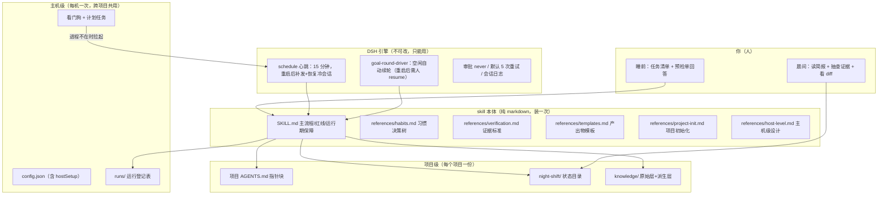
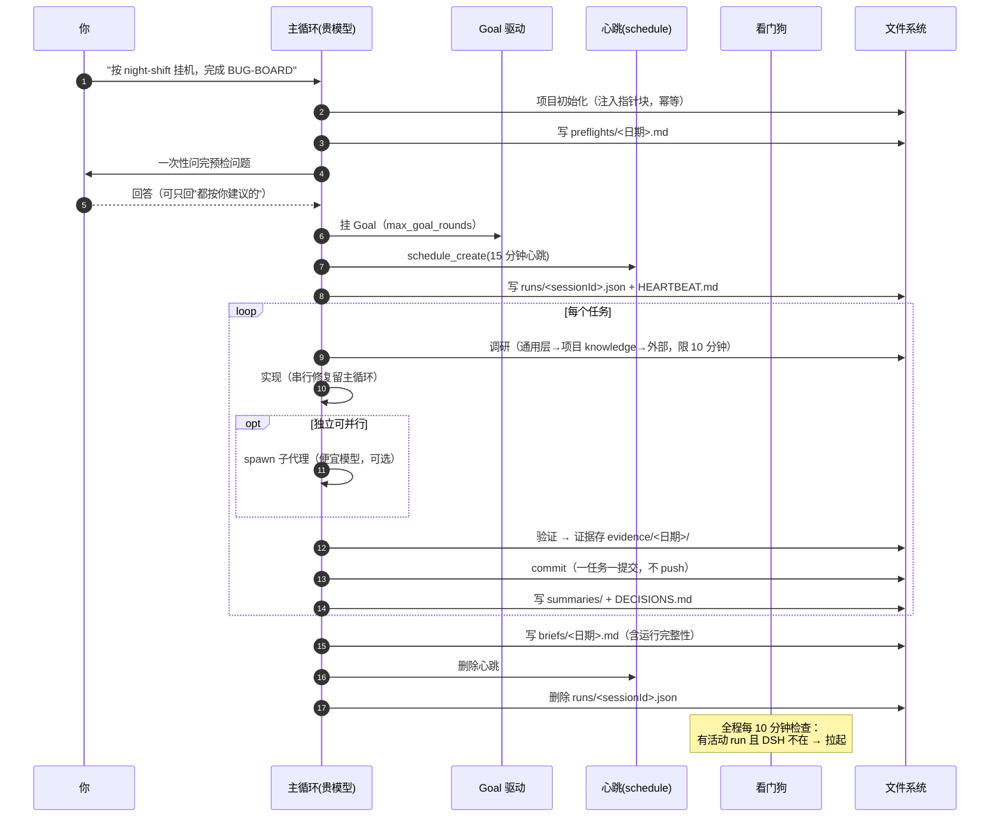
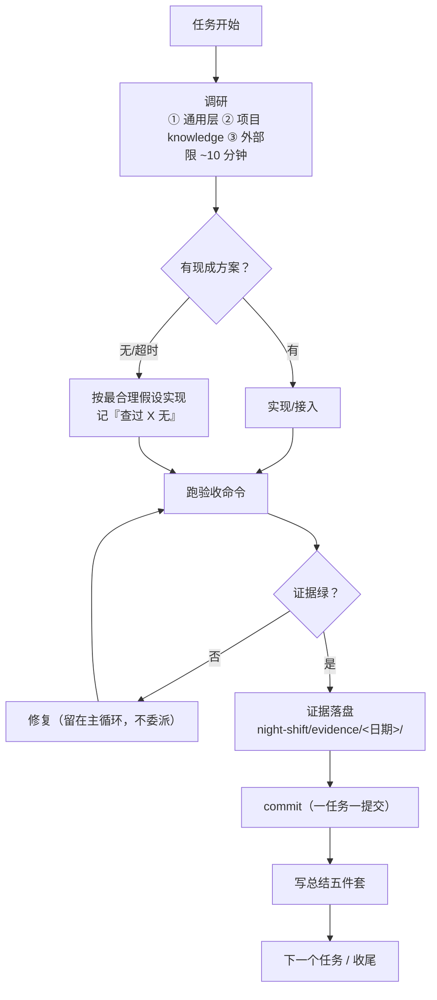
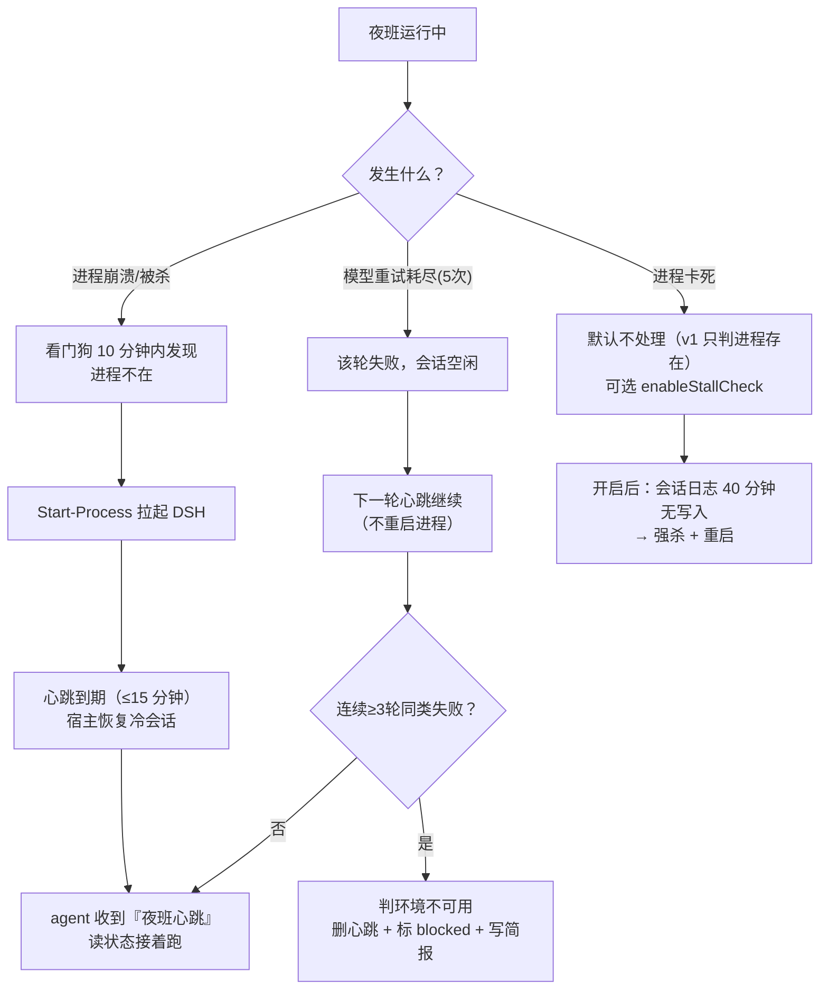
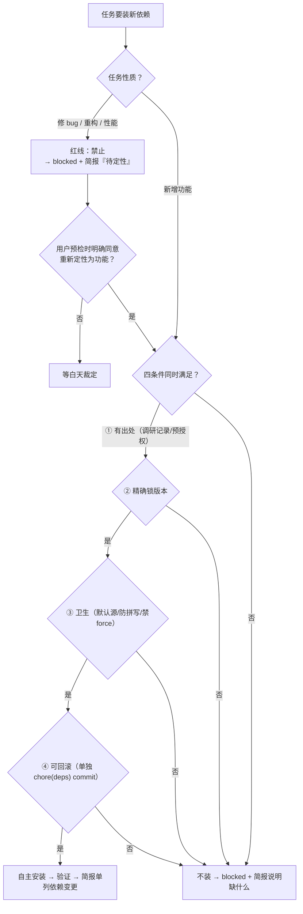
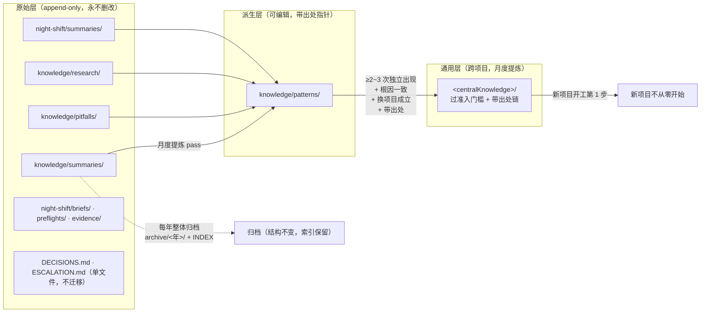

# Night Shift 设计说明（给人和给未来的维护者）

> **English abstract**: This document explains the structure of the night-shift skill — four layers (skill body / project / host / engine), one-night sequence, per-task loop, crash recovery (watchdog + heartbeat), dependency decision tree, knowledge layers, file map, parameters, and common misconceptions. Full English manual: [`README.en.md`](README.en.md). Diagrams use Mermaid; an ASCII overview is at the top for viewers without Mermaid support.

> 本文回答三个问题：**它由哪些部分组成**、**一夜是怎么跑的**、**出问题时谁兜底**。
> 规则细节见 `SKILL.md`（agent 手册）与 `README.md`（人用手册）；本文只讲结构与流向。
> **适用范围**：名字叫 night-shift，但触发条件是"**人不在设备前**"（出门/开会/通勤/吃饭/睡觉），不限夜间。

---

## 一页看懂（ASCII）

```
                          ┌──────────────────────────────────────────┐
   你（睡前 3 分钟）       │  任务清单 BUG-BOARD.md / TODO            │
        │                 └──────────────────────────────────────────┘
        ▼
  「按 night-shift 挂机」
        │
        ▼
 ┌───────────────┐   一次性    ┌────────────────────────────────────┐
 │ 预检单         │──────────▶ │ 你能拍板的：需求歧义/设计取舍/依赖预授权 │
 └───────────────┘             └────────────────────────────────────┘
        │ 没答的落回习惯默认
        ▼
 ┌──────────────────────────────────────────────────────────────────┐
 │ 主循环（你选的模型）：项目初始化 → 挂 Goal → 建心跳 → 写运行登记表   │
 │   ┌──────────────────────────────────────────────────────────┐   │
 │   │ 任务 N：调研 → 实现 → 验证出证据 → commit → 写总结          │   │
 │   │         ↑________ 失败就修，串行留在主循环 ________|        │   │
 │   └──────────────────────────────────────────────────────────┘   │
 └──────────────────────────────────────────────────────────────────┘
        │                                    ▲
        │ 独立可并行任务 → 子代理（便宜模型）  │ 心跳 15 分钟 / Goal 续轮
        ▼                                    │
 ┌──────────────────────────┐        ┌───────┴──────────────┐
 │ 收尾：写简报 → 删心跳     │        │ DSH 引擎（schedule）  │
 │       → 删运行登记表      │        └───────┬──────────────┘
 └──────────────────────────┘                │ 进程死了？
                                             ▼
                              ┌──────────────────────────────┐
                              │ 看门狗（每 10 分钟，主机级）    │
                              │ 有活动夜班 + 进程不在 → 拉起   │
                              └──────────────────────────────┘
```

---

## 一、全景架构：四层 + 两条外部依赖



**分层职责（关键：别混层）**

| 层 | 内容 | 装几次 | 谁维护 |
|---|---|---|---|
| **skill 本体** | `SKILL.md` + `references/*.md`（纯 markdown） | 一次（复制到 `~/.dsh/skills/`） | 你/我，改仓库后复制 |
| **项目级** | 项目 `AGENTS.md` 指针块、`night-shift/` 状态、`knowledge/` | 每项目一次（skill 自动做） | skill 运行时自动写 |
| **主机级** | `config.json`、`runs/`、看门狗 + 计划任务 | 每机一次（手动装） | 你批准后执行脚本 |
| **引擎** | 心跳、Goal 续轮、审批、重试、会话日志 | 不装（DSH 自带） | DSH |

**两条外部依赖（缺了会怎样）**

| 依赖 | 缺了会怎样 | 替代 |
|---|---|---|
| `schedule`（心跳） | 崩溃重启后没人叫醒会话 → 停到早上 | 无（这是唯一的自动续跑机制） |
| 看门狗（计划任务） | DSH 进程崩了不会自己回来 | 你手动打开 DSH，心跳会自动接上 |

---

## 二、一夜的完整时序



---

## 三、单任务闭环（为什么"证据"是唯一裁判）



**红线（任何情况下不越）**：`git push`、C 级禁区、**修复类任务装新依赖**。

---

## 四、崩溃恢复链路（这是"无人值守"的真正含义）



**为什么不用 Goal 续轮兜底**：`goal-round-driver` 在会话 resume/fork 后**保持停用**，必须人明确授权 resume——引擎不会自己复活工作。所以崩溃恢复靠"心跳"这条独立驱动源，不依赖 Goal。

**为什么"卡死判定"默认关闭**：存活信号只能用引擎写的（会话日志 mtime）。任务时长不能当阈值——跑 1 小时的长任务期间模型在忙，用"多久没动静"判死会误杀。

---

## 五、依赖决策树（修复类红线 vs 功能类豁免）



---

## 六、知识沉淀流向（原始层是唯一事实源）



**准入门槛四条**：≥2~3 次独立出现（不同项目，或间隔 ≥7 天的不同任务）→ 根因确认一致 → 换个项目还成立 → 带出处链。
**退役不删除**：证伪条目 `refuted + 日期 + 证据指针`，原件永远在。

---

## 七、文件地图

```
仓库（`<skill-repo>/night-shift/`）                      ← 唯一维护点
├── SKILL.md               agent 主手册
├── README.md              人用手册
├── DESIGN.md              本文（设计说明）
├── references/
│   ├── habits.md          习惯决策树（自由区/禁区/默认表）
│   ├── verification.md    证据标准与失败处置
│   ├── templates.md       预检单/总结/决策日志/简报模板
│   ├── project-init.md    项目初始化（指针块 + 三层结构）
│   └── host-level.md      主机级（登记表/看门狗/OS 差异）
└── scripts/               可选主机脚本（不被 skill 加载）
    ├── windows/{setup.ps1, watchdog-launch.vbs, watchdog.ps1}
    └── macos/{setup.sh, watchdog.sh}

安装副本（~\.dsh\skills\night-shift\）                       ← DSH 实际加载
（与仓库逐文件一致；改仓库后重新复制）

主机级（~\.dsh\night-shift\）                                ← 跨项目共用
├── config.json            centralKnowledge / dshExecutable / 心跳与阈值 / hostSetup
├── runs/<sessionId>.json  运行登记表（夜班进行中才有）
├── watchdog.log           只在状态变化时写
└── scripts/               主机副本（计划任务 → watchdog-launch.vbs → watchdog.ps1）

项目级（各项目工作区）                                        ← 每项目一份
├── AGENTS.md              + 指针块（类型/集中层路径/规则正文指针/项目差量）
├── knowledge/
│   ├── summaries/ pitfalls/ research/   ← 原始层
│   ├── patterns/                        ← 派生层（提炼 pass 写）
│   └── archive/<年>/                    ← 年度归档
└── night-shift/
    ├── preflights/<日期>.md
    ├── briefs/<日期>.md
    ├── DECISIONS.md
    ├── ESCALATION.md
    ├── HEARTBEAT.md
    ├── summaries/
    └── evidence/<日期>/
```

---

## 八、状态与幂等（为什么重启不需要重新初始化）

| 状态 | 标记 | 谁写 | 何时失效 |
|---|---|---|---|
| 项目已初始化 | 项目 AGENTS.md 里 `<!-- night-shift-knowledge:v0 项目类型=… -->` | skill | 类型判定变化时才重写 |
| 子代理模型已配 | `config.json` → `hostSetup.subagentModel.configured` | 你/脚本 | 换 preset 时 |
| 看门狗已装 | `config.json` → `hostSetup.watchdog.installed` | setup.ps1 | 卸载时 |
| 夜班进行中 | `runs/<sessionId>.json`（`startedAt` 18 小时内） | skill | 收尾删除 / 超 18h 视为陈旧 |
| 心跳在跑 | `HEARTBEAT.md` 记的提醒 id | skill | 收尾删除 |

**重启只做三件事**：启动进程 → 心跳到期恢复冷会话 → agent 读状态接着跑。**不写任何项目文件、不重新初始化。**

---

## 九、关键参数

| 参数 | 值 | 在哪改 | 为什么 |
|---|---|---|---|
| 心跳间隔 | 15 分钟（默认） | `config.json.heartbeatSeconds`（SKILL 建提醒时读） | 改小→恢复快但更贵；改大→相反 |
| 看门狗周期 | 10 分钟 | 计划任务 | 与心跳错开，崩溃后 10 分钟内发现 |
| 陈旧 run | 18 小时 | `config.json.staleHours` | 防收尾漏删导致白天反复重启 |
| 卡死阈值 | 40 分钟（默认关） | `config.json.stallMinutes` + `enableStallCheck` | ≈2×心跳 + 10 分钟余量；默认关避免误杀长任务 |
| 模型重试 | 5 次（默认） | profile `retryPolicy.maxRetries` | 不改全局 `always`；耗尽由心跳接管 |
| 调研时间盒 | ~10 分钟/任务 | project-init 模板 | 防止整晚卡在调研 |
| 子代理模型 | 由你的 preset 决定（选个便宜的） | 用户 preset `tool-subagent.agentOptions` | 默认继承父模型，必须显式配置才便宜 |
| 子代理输出上限 | 省略（= 模型默认） | preset `agentOptions.maxTokens` | 是**单次输出上限**，不是上下文窗口 |

---

## 十、常见误解

| 误解 | 实际 |
|---|---|
| "看门狗是常驻进程，一直在监控" | 不是。计划任务每 10 分钟启动它一次，检查完毫秒级退出 |
| "没有 RUNNING 文件所以不监控" | 用的是**运行登记表** `runs/*.json`，不是文件标记 |
| "开机自启 DSH" | 不做。不打开 DSH = 你不需要；看门狗只在"夜班进行中"才拉起 |
| "Goal 续轮能兜住崩溃" | 不能。重启后 Goal 续行停用，必须靠心跳 |
| "重启要重新初始化" | 不用。项目级靠标记、主机级靠 config，全幂等 |
| "子代理自动就便宜" | 不是。默认继承父模型，必须配 `agentOptions` |
| "重试无限更保险" | 不是。provider 级配置会拖累白天；且余额不足时无限重试无意义 |
| "原始层永不移动" | 已修订为"永不删除；允许按年整体归档迁移" |
| **"模型重试 5 次失败后夜班就停了"** | **不停**。单轮失败 → 会话空闲 → **Goal 驱动器自动开下一轮**继续尝试。三道刹车防整夜空转：`blockedAfterConsecutiveRounds=3`（连续 3 轮受阻必须标 blocked）、`max_goal_rounds`（耗尽记 `round-limit`）、心跳规则（连续 ≥3 轮同类失败 → 删心跳 + blocked + 简报） |
| "Goal 续轮和心跳是一回事" | 不是，是**两条独立驱动源**：Goal 续轮管"一轮干完接着下一轮"（同会话内）；心跳管"会话被冷启动/重启后重新叫醒"（跨进程）。Goal 重启后停用，心跳不会 |

---

## 十一、两条驱动源的分工（最容易被混淆的点）

```
正常一夜：
  Goal 驱动器 ──"一轮干完 → 自动下一轮"──▶ 主循环（同会话内，进程活着）

进程崩溃/重启后：
  Goal 驱动器 ✗（resume 后停用，需人授权）
  心跳 ──"15 分钟到点 → 恢复冷会话 → 投递『夜班心跳』"──▶ 主循环（跨进程）

模型重试耗尽：
  该轮报错结束 → 会话空闲 → Goal 驱动器自动开下一轮（同会话内继续）
  连续 ≥3 轮同类失败 → 心跳规则要求 agent 标 blocked + 删心跳 + 写简报（止损）
```

**为什么不能只留一条**：

- 只留 Goal：崩溃后没人叫醒（Goal 停用），夜班停到早上；
- 只留心跳：15 分钟才推一轮，任务推进太慢（Goal 是"干完立刻下一轮"）。

**为什么要设 `max_goal_rounds`**：它是最后一道机械保险——额度耗尽时引擎记 `round-limit` blocker 并停止续行，不依赖模型"自觉"踩刹车。建议值 20~40（够干完一批任务，又不至于整夜空转）。

**一个已知不确定点（如实记录）**：引擎文档说"只有进入模型历史的 goal Round 才消耗额度"。若某次 LLM 调用在重试耗尽后**没有进入模型历史**，理论上存在"驱动器反复起轮、每轮失败、额度不减"的窗口。缓解：`max_goal_rounds` 设保守值 + SKILL 要求连续 3 轮同类失败主动标 blocked + v1 不开卡死自动重启（避免重启循环）；首夜观察 token 统计与简报。
